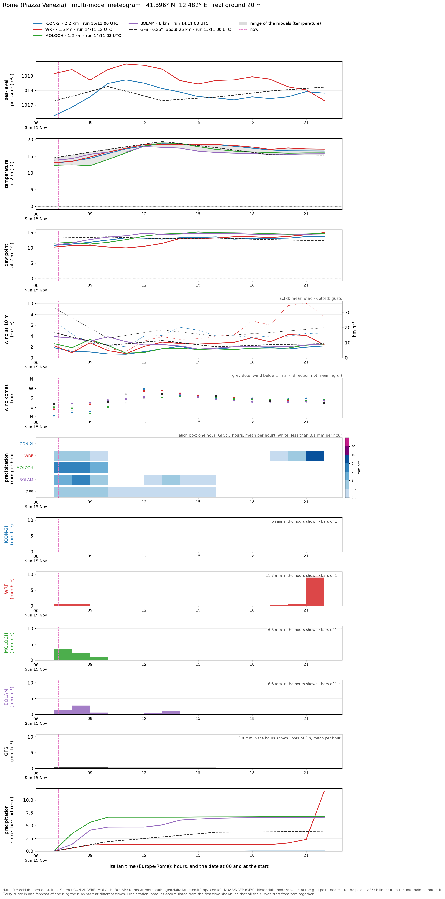

# Rome · multi-model meteogram

**Sunday 15 November 2026, 07:00 → 22:00** (Italian time) · updated 15/11 07:14



```
summary from Sun 15 Nov 06 UTC to Sun 15 Nov 21 UTC (precipitation up to Sun 15 Nov 21 UTC, the last time common to all the models):
model     run (UTC)         grid    point  ground  T min  T max  precip  max gust
ICON-2I   15/11 00        2.2 km   0.8 km    35 m   13.0   18.7  0.0 mm   25 km/h
WRF       14/11 12        1.5 km   0.3 km    41 m   13.1   18.6 11.7 mm   36 km/h
MOLOCH    14/11 03        1.2 km   0.2 km    n.a.   12.1   19.0  6.8 mm      n.a.
BOLAM     14/11 00          8 km   2.7 km    n.a.   13.8   17.9  6.6 mm      n.a.
GFS       15/11 00         0.25°   0.0 km    82 m   14.5   19.4  3.9 mm   33 km/h
spread of the models: highest temperature 17.9 to 19.4 °C; lowest 12.1 to 14.5 °C; precipitation 0.0 to 11.7 mm
'point': distance of the grid point used from the place; 'ground': height of the model ground there (Rome (Piazza Venezia): about 20 m; a model ground 100 m lower is about 0.65 °C warmer)
```

Models: ICON-2I (2.2 km), WRF (1.5 km), MOLOCH (1.2 km), BOLAM (8 km) from MeteoHub (ItaliaMeteo); GFS (25 km) from NOAA. Every curve is one forecast of one run.

Previous days: [14/11](meteograms/meteogram_Rome_2026111423.png) · [14/11](meteograms/meteogram_Rome_2026111409.png) · [13/11](meteograms/meteogram_Rome_2026111315.png) · [13/11](meteograms/meteogram_Rome_2026111309.png) · [12/11](meteograms/meteogram_Rome_2026111223.png)
