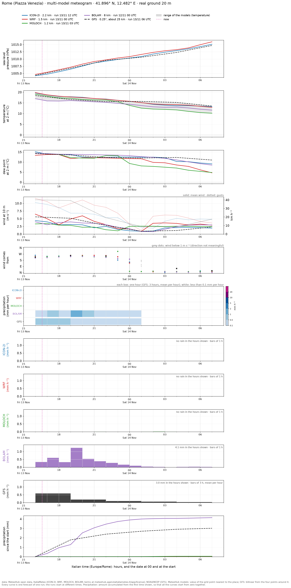

# Rome · multi-model meteogram

**Friday 13 November 2026, 16:00 → 07:00** (Italian time) · updated 13/11 16:34



```
summary from Fri 13 Nov 15 UTC to Sat 14 Nov 06 UTC (precipitation up to Sat 14 Nov 06 UTC, the last time common to all the models):
model     run (UTC)         grid    point  ground  T min  T max  precip  max gust
ICON-2I   13/11 12        2.2 km   0.8 km    35 m   13.3   19.7  0.0 mm   37 km/h
WRF       13/11 00        1.5 km   0.3 km    41 m   12.9   19.8  0.0 mm   42 km/h
MOLOCH    13/11 03        1.2 km   0.2 km    n.a.   10.2   19.1  0.0 mm      n.a.
BOLAM     12/11 00          8 km   2.7 km    n.a.   11.6   17.0  4.1 mm      n.a.
GFS       13/11 06         0.25°   0.0 km    82 m   13.5   18.4  3.0 mm   40 km/h
spread of the models: highest temperature 17.0 to 19.8 °C; lowest 10.2 to 13.5 °C; precipitation 0.0 to 4.1 mm
'point': distance of the grid point used from the place; 'ground': height of the model ground there (Rome (Piazza Venezia): about 20 m; a model ground 100 m lower is about 0.65 °C warmer)
```

Models: ICON-2I (2.2 km), WRF (1.5 km), MOLOCH (1.2 km), BOLAM (8 km) from MeteoHub (ItaliaMeteo); GFS (25 km) from NOAA. Every curve is one forecast of one run.

Previous days: [13/11](meteograms/meteogram_Rome_2026111309.png) · [12/11](meteograms/meteogram_Rome_2026111223.png)
