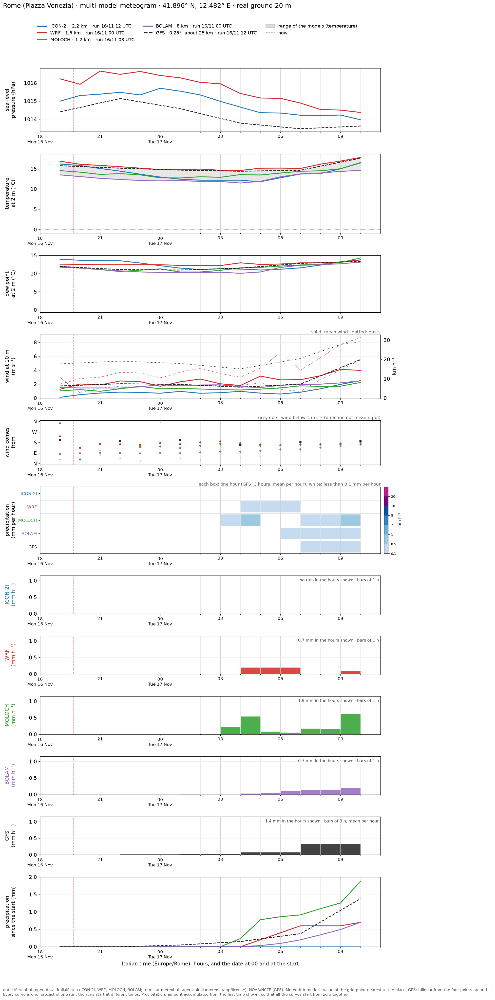

# Rome · multi-model meteogram

**Monday 16 November 2026, 19:00 → 10:00** (Italian time) · updated 16/11 19:41



```
summary from Mon 16 Nov 18 UTC to Tue 17 Nov 09 UTC (precipitation up to Tue 17 Nov 09 UTC, the last time common to all the models):
model     run (UTC)         grid    point  ground  T min  T max  precip  max gust
ICON-2I   16/11 12        2.2 km   0.8 km    35 m   11.8   16.4  0.0 mm   20 km/h
WRF       16/11 00        1.5 km   0.3 km    41 m   14.6   17.8  0.7 mm   29 km/h
MOLOCH    16/11 03        1.2 km   0.2 km    n.a.   12.7   16.5  1.9 mm      n.a.
BOLAM     16/11 00          8 km   2.7 km    n.a.   11.5   14.6  0.7 mm      n.a.
GFS       16/11 12         0.25°   0.0 km    82 m   14.4   17.6  1.4 mm   31 km/h
spread of the models: highest temperature 14.6 to 17.8 °C; lowest 11.5 to 14.6 °C; precipitation 0.0 to 1.9 mm
'point': distance of the grid point used from the place; 'ground': height of the model ground there (Rome (Piazza Venezia): about 20 m; a model ground 100 m lower is about 0.65 °C warmer)
```

Models: ICON-2I (2.2 km), WRF (1.5 km), MOLOCH (1.2 km), BOLAM (8 km) from MeteoHub (ItaliaMeteo); GFS (25 km) from NOAA. Every curve is one forecast of one run.

Previous days: [15/11](meteograms/meteogram_Rome_2026111506.png) · [14/11](meteograms/meteogram_Rome_2026111423.png) · [14/11](meteograms/meteogram_Rome_2026111409.png) · [13/11](meteograms/meteogram_Rome_2026111315.png) · [13/11](meteograms/meteogram_Rome_2026111309.png) · [12/11](meteograms/meteogram_Rome_2026111223.png)
