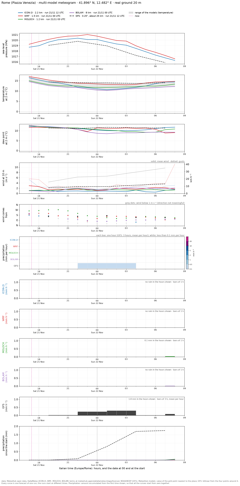

# Rome · multi-model meteogram

**Saturday 21 November 2026, 17:00 → 08:00** (Italian time) · updated 21/11 17:15



```
summary from Sat 21 Nov 16 UTC to Sun 22 Nov 07 UTC (precipitation up to Sun 22 Nov 07 UTC, the last time common to all the models):
model     run (UTC)         grid    point  ground  T min  T max  precip  max gust
ICON-2I   21/11 12        2.2 km   0.8 km    35 m   10.6   16.5  0.0 mm   19 km/h
WRF       21/11 00        1.5 km   0.3 km    41 m   13.0   17.1  0.0 mm   40 km/h
MOLOCH    21/11 03        1.2 km   0.2 km    n.a.   11.8   15.0  0.1 mm      n.a.
BOLAM     21/11 00          8 km   2.7 km    n.a.   10.3   14.5  0.0 mm      n.a.
GFS       21/11 12         0.25°   0.0 km    82 m   13.7   14.5  1.8 mm   35 km/h
spread of the models: highest temperature 14.5 to 17.1 °C; lowest 10.3 to 13.7 °C; precipitation 0.0 to 1.8 mm
'point': distance of the grid point used from the place; 'ground': height of the model ground there (Rome (Piazza Venezia): about 20 m; a model ground 100 m lower is about 0.65 °C warmer)
```

Models: ICON-2I (2.2 km), WRF (1.5 km), MOLOCH (1.2 km), BOLAM (8 km) from MeteoHub (ItaliaMeteo); GFS (25 km) from NOAA. Every curve is one forecast of one run.

Previous days: [20/11](meteograms/meteogram_Rome_2026112017.png) · [19/11](meteograms/meteogram_Rome_2026111917.png) · [18/11](meteograms/meteogram_Rome_2026111817.png) · [17/11](meteograms/meteogram_Rome_2026111717.png) · [16/11](meteograms/meteogram_Rome_2026111618.png) · [15/11](meteograms/meteogram_Rome_2026111506.png) · [14/11](meteograms/meteogram_Rome_2026111423.png) · [14/11](meteograms/meteogram_Rome_2026111409.png) · [13/11](meteograms/meteogram_Rome_2026111315.png) · [13/11](meteograms/meteogram_Rome_2026111309.png) · [12/11](meteograms/meteogram_Rome_2026111223.png)
