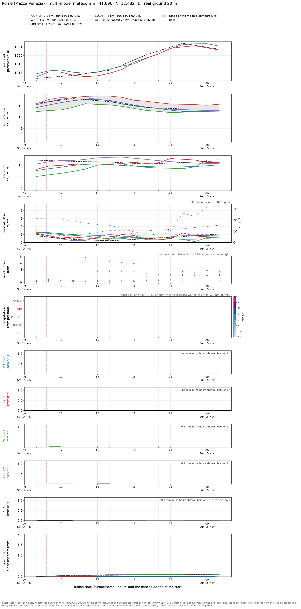

# Rome · multi-model meteogram

**Saturday 14 November 2026, 10:00 → 01:00** (Italian time) · updated 14/11 10:48



```
summary from Sat 14 Nov 09 UTC to Sun 15 Nov 00 UTC (precipitation up to Sun 15 Nov 00 UTC, the last time common to all the models):
model     run (UTC)         grid    point  ground  T min  T max  precip  max gust
ICON-2I   14/11 00        2.2 km   0.8 km    35 m   12.5   17.9  0.0 mm   21 km/h
WRF       14/11 00        1.5 km   0.3 km    41 m   15.3   19.5  0.0 mm   33 km/h
MOLOCH    14/11 03        1.2 km   0.2 km    n.a.   12.1   16.0  0.1 mm      n.a.
BOLAM     14/11 00          8 km   2.7 km    n.a.   12.9   18.7  0.1 mm      n.a.
GFS       14/11 06         0.25°   0.0 km    82 m   13.6   18.3  0.1 mm   15 km/h
spread of the models: highest temperature 16.0 to 19.5 °C; lowest 12.1 to 15.3 °C; precipitation 0.0 to 0.1 mm
'point': distance of the grid point used from the place; 'ground': height of the model ground there (Rome (Piazza Venezia): about 20 m; a model ground 100 m lower is about 0.65 °C warmer)
```

Models: ICON-2I (2.2 km), WRF (1.5 km), MOLOCH (1.2 km), BOLAM (8 km) from MeteoHub (ItaliaMeteo); GFS (25 km) from NOAA. Every curve is one forecast of one run.

Previous days: [13/11](meteograms/meteogram_Rome_2026111315.png) · [13/11](meteograms/meteogram_Rome_2026111309.png) · [12/11](meteograms/meteogram_Rome_2026111223.png)
