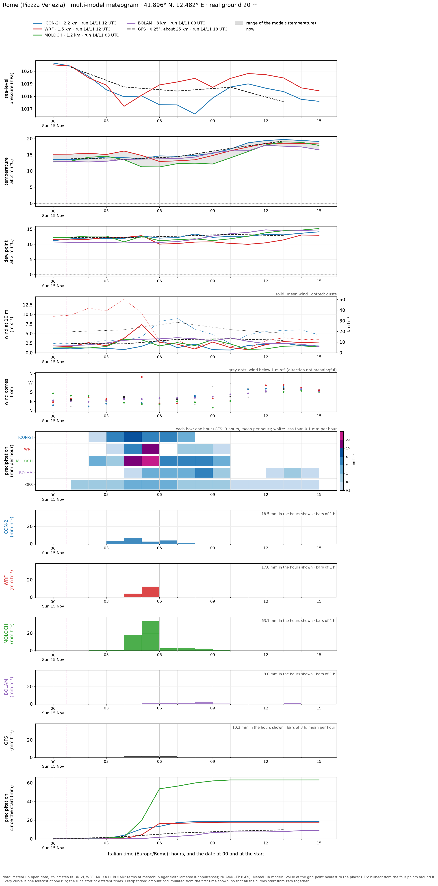

# Rome · multi-model meteogram

**Sunday 15 November 2026, 00:00 → 15:00** (Italian time) · updated 15/11 00:46



```
summary from Sat 14 Nov 23 UTC to Sun 15 Nov 14 UTC (precipitation up to Sun 15 Nov 14 UTC, the last time common to all the models):
model     run (UTC)         grid    point  ground  T min  T max  precip  max gust
ICON-2I   14/11 12        2.2 km   0.8 km    35 m   13.5   19.7 18.5 mm   32 km/h
WRF       14/11 12        1.5 km   0.3 km    41 m   12.9   18.6 17.8 mm   50 km/h
MOLOCH    14/11 03        1.2 km   0.2 km    n.a.   11.2   19.0 63.1 mm      n.a.
BOLAM     14/11 00          8 km   2.7 km    n.a.   12.8   17.9  9.0 mm      n.a.
GFS       14/11 18         0.25°   0.0 km    82 m   13.6   19.2 10.3 mm   29 km/h
spread of the models: highest temperature 17.9 to 19.7 °C; lowest 11.2 to 13.6 °C; precipitation 9.0 to 63.1 mm
'point': distance of the grid point used from the place; 'ground': height of the model ground there (Rome (Piazza Venezia): about 20 m; a model ground 100 m lower is about 0.65 °C warmer)
```

Models: ICON-2I (2.2 km), WRF (1.5 km), MOLOCH (1.2 km), BOLAM (8 km) from MeteoHub (ItaliaMeteo); GFS (25 km) from NOAA. Every curve is one forecast of one run.

Previous days: [14/11](meteograms/meteogram_Rome_2026111409.png) · [13/11](meteograms/meteogram_Rome_2026111315.png) · [13/11](meteograms/meteogram_Rome_2026111309.png) · [12/11](meteograms/meteogram_Rome_2026111223.png)
