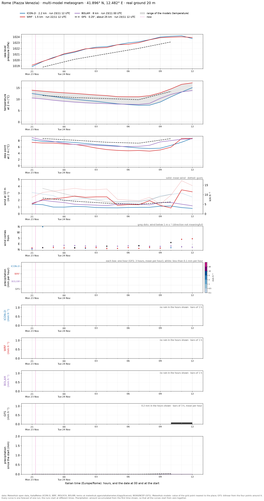

# Rome · multi-model meteogram

**Monday 23 November 2026, 21:00 → 12:00** (Italian time) · updated 23/11 21:19



**Missing today:** MOLOCH: not used, its forecast ends before 23/11 20 UTC

```
summary from Mon 23 Nov 20 UTC to Tue 24 Nov 11 UTC (precipitation up to Tue 24 Nov 11 UTC, the last time common to all the models):
model     run (UTC)         grid    point  ground  T min  T max  precip  max gust
ICON-2I   23/11 12        2.2 km   0.8 km    35 m    7.4   15.1  0.0 mm   11 km/h
WRF       22/11 12        1.5 km   0.3 km    41 m   11.1   17.2  0.0 mm   17 km/h
BOLAM     23/11 00          8 km   2.7 km    n.a.    7.7   13.8  0.0 mm      n.a.
GFS       23/11 12         0.25°   0.0 km    82 m    9.8   13.5  0.2 mm   13 km/h
spread of the models: highest temperature 13.5 to 17.2 °C; lowest 7.4 to 11.1 °C; precipitation 0.0 to 0.2 mm
'point': distance of the grid point used from the place; 'ground': height of the model ground there (Rome (Piazza Venezia): about 20 m; a model ground 100 m lower is about 0.65 °C warmer)
```

Models: ICON-2I (2.2 km), WRF (1.5 km), MOLOCH (1.2 km), BOLAM (8 km) from MeteoHub (ItaliaMeteo); GFS (25 km) from NOAA. Every curve is one forecast of one run.

Previous days: [22/11](meteograms/meteogram_Rome_2026112216.png) · [21/11](meteograms/meteogram_Rome_2026112116.png) · [20/11](meteograms/meteogram_Rome_2026112017.png) · [19/11](meteograms/meteogram_Rome_2026111917.png) · [18/11](meteograms/meteogram_Rome_2026111817.png) · [17/11](meteograms/meteogram_Rome_2026111717.png) · [16/11](meteograms/meteogram_Rome_2026111618.png) · [15/11](meteograms/meteogram_Rome_2026111506.png) · [14/11](meteograms/meteogram_Rome_2026111423.png) · [14/11](meteograms/meteogram_Rome_2026111409.png) · [13/11](meteograms/meteogram_Rome_2026111315.png) · [13/11](meteograms/meteogram_Rome_2026111309.png) · [12/11](meteograms/meteogram_Rome_2026111223.png)
