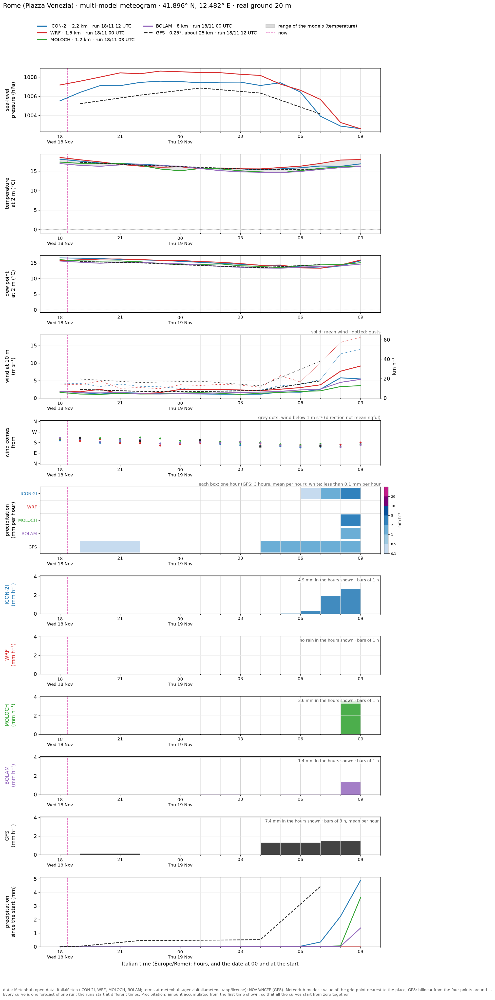

# Rome · multi-model meteogram

**Wednesday 18 November 2026, 18:00 → 09:00** (Italian time) · updated 18/11 18:22



```
summary from Wed 18 Nov 17 UTC to Thu 19 Nov 08 UTC (precipitation up to Thu 19 Nov 08 UTC, the last time common to all the models):
model     run (UTC)         grid    point  ground  T min  T max  precip  max gust
ICON-2I   18/11 12        2.2 km   0.8 km    35 m   15.4   18.1  4.9 mm   50 km/h
WRF       18/11 00        1.5 km   0.3 km    41 m   15.6   18.5  0.0 mm   62 km/h
MOLOCH    18/11 03        1.2 km   0.2 km    n.a.   14.6   17.3  3.6 mm      n.a.
BOLAM     18/11 00          8 km   2.7 km    n.a.   14.6   17.0  1.4 mm      n.a.
GFS       18/11 12         0.25°   0.0 km    82 m   15.4   17.3  7.4 mm   38 km/h
spread of the models: highest temperature 17.0 to 18.5 °C; lowest 14.6 to 15.6 °C; precipitation 0.0 to 7.4 mm
'point': distance of the grid point used from the place; 'ground': height of the model ground there (Rome (Piazza Venezia): about 20 m; a model ground 100 m lower is about 0.65 °C warmer)
```

Models: ICON-2I (2.2 km), WRF (1.5 km), MOLOCH (1.2 km), BOLAM (8 km) from MeteoHub (ItaliaMeteo); GFS (25 km) from NOAA. Every curve is one forecast of one run.

Previous days: [17/11](meteograms/meteogram_Rome_2026111717.png) · [16/11](meteograms/meteogram_Rome_2026111618.png) · [15/11](meteograms/meteogram_Rome_2026111506.png) · [14/11](meteograms/meteogram_Rome_2026111423.png) · [14/11](meteograms/meteogram_Rome_2026111409.png) · [13/11](meteograms/meteogram_Rome_2026111315.png) · [13/11](meteograms/meteogram_Rome_2026111309.png) · [12/11](meteograms/meteogram_Rome_2026111223.png)
