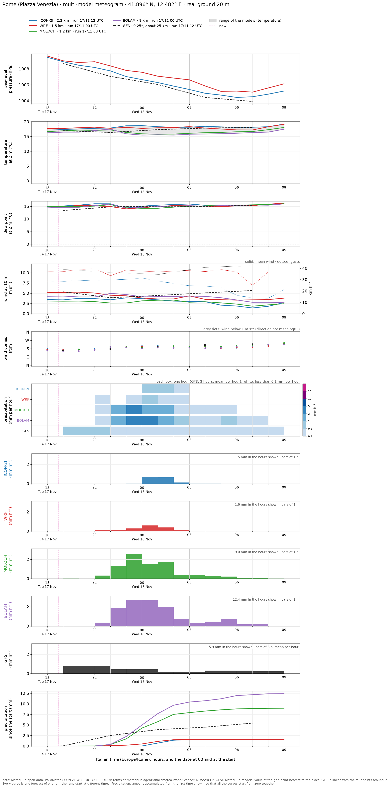

# Rome · multi-model meteogram

**Tuesday 17 November 2026, 18:00 → 09:00** (Italian time) · updated 17/11 18:42



```
summary from Tue 17 Nov 17 UTC to Wed 18 Nov 08 UTC (precipitation up to Wed 18 Nov 08 UTC, the last time common to all the models):
model     run (UTC)         grid    point  ground  T min  T max  precip  max gust
ICON-2I   17/11 12        2.2 km   0.8 km    35 m   17.4   19.2  1.5 mm   32 km/h
WRF       17/11 00        1.5 km   0.3 km    41 m   17.2   19.1  1.6 mm   40 km/h
MOLOCH    17/11 03        1.2 km   0.2 km    n.a.   15.8   18.1  9.0 mm      n.a.
BOLAM     17/11 00          8 km   2.7 km    n.a.   15.5   17.5 12.4 mm      n.a.
GFS       17/11 12         0.25°   0.0 km    82 m   16.4   18.1  5.9 mm   42 km/h
spread of the models: highest temperature 17.5 to 19.2 °C; lowest 15.5 to 17.4 °C; precipitation 1.5 to 12.4 mm
'point': distance of the grid point used from the place; 'ground': height of the model ground there (Rome (Piazza Venezia): about 20 m; a model ground 100 m lower is about 0.65 °C warmer)
```

Models: ICON-2I (2.2 km), WRF (1.5 km), MOLOCH (1.2 km), BOLAM (8 km) from MeteoHub (ItaliaMeteo); GFS (25 km) from NOAA. Every curve is one forecast of one run.

Previous days: [16/11](meteograms/meteogram_Rome_2026111618.png) · [15/11](meteograms/meteogram_Rome_2026111506.png) · [14/11](meteograms/meteogram_Rome_2026111423.png) · [14/11](meteograms/meteogram_Rome_2026111409.png) · [13/11](meteograms/meteogram_Rome_2026111315.png) · [13/11](meteograms/meteogram_Rome_2026111309.png) · [12/11](meteograms/meteogram_Rome_2026111223.png)
