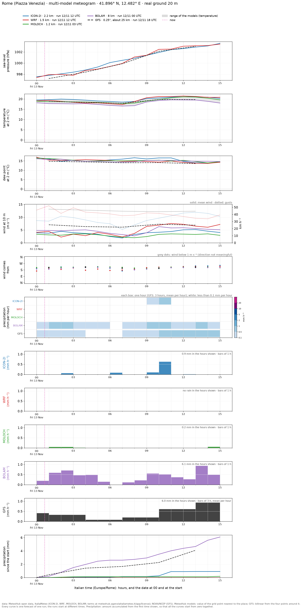

# Rome · multi-model meteogram

**Friday 13 November 2026, 00:00 → 15:00** (Italian time) · updated 13/11 00:39



```
summary from Thu 12 Nov 23 UTC to Fri 13 Nov 14 UTC (precipitation up to Fri 13 Nov 14 UTC, the last time common to all the models):
model     run (UTC)         grid    point  ground  T min  T max  precip  max gust
ICON-2I   12/11 12        2.2 km   0.8 km    35 m   18.5   21.4  0.9 mm   43 km/h
WRF       12/11 12        1.5 km   0.3 km    41 m   17.3   21.4  0.0 mm   52 km/h
MOLOCH    12/11 03        1.2 km   0.2 km    n.a.   17.8   21.1  0.2 mm      n.a.
BOLAM     12/11 00          8 km   2.7 km    n.a.   16.6   19.6  6.1 mm      n.a.
GFS       12/11 18         0.25°   0.0 km    82 m   17.9   19.8  6.0 mm   47 km/h
spread of the models: highest temperature 19.6 to 21.4 °C; lowest 16.6 to 18.5 °C; precipitation 0.0 to 6.1 mm
'point': distance of the grid point used from the place; 'ground': height of the model ground there (Rome (Piazza Venezia): about 20 m; a model ground 100 m lower is about 0.65 °C warmer)
```

Models: ICON-2I (2.2 km), WRF (1.5 km), MOLOCH (1.2 km), BOLAM (8 km) from MeteoHub (ItaliaMeteo); GFS (25 km) from NOAA. Every curve is one forecast of one run.

Previous days: none yet
