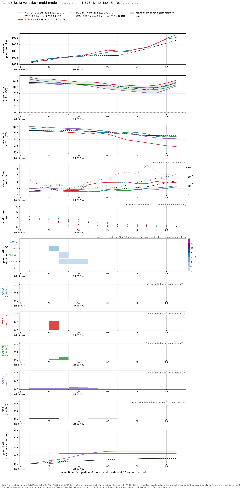

# Rome · multi-model meteogram

**Friday 27 November 2026, 19:00 → 10:00** (Italian time) · updated 27/11 19:17



```
summary from Fri 27 Nov 18 UTC to Sat 28 Nov 09 UTC (precipitation up to Sat 28 Nov 09 UTC, the last time common to all the models):
model     run (UTC)         grid    point  ground  T min  T max  precip  max gust
ICON-2I   27/11 12        2.2 km   0.8 km    35 m    9.7   13.1  0.0 mm   22 km/h
WRF       27/11 00        1.5 km   0.3 km    41 m   10.4   13.9  0.6 mm   32 km/h
MOLOCH    27/11 03        1.2 km   0.2 km    n.a.    8.8   11.9  0.3 mm      n.a.
BOLAM     27/11 00          8 km   2.7 km    n.a.    7.7   11.3  0.7 mm      n.a.
GFS       27/11 12         0.25°   0.0 km    82 m    8.9   11.8  0.3 mm   22 km/h
spread of the models: highest temperature 11.3 to 13.9 °C; lowest 7.7 to 10.4 °C; precipitation 0.0 to 0.7 mm
'point': distance of the grid point used from the place; 'ground': height of the model ground there (Rome (Piazza Venezia): about 20 m; a model ground 100 m lower is about 0.65 °C warmer)
```

Models: ICON-2I (2.2 km), WRF (1.5 km), MOLOCH (1.2 km), BOLAM (8 km) from MeteoHub (ItaliaMeteo); GFS (25 km) from NOAA. Every curve is one forecast of one run.

Previous days: [26/11](meteograms/meteogram_Rome_2026112618.png) · [25/11](meteograms/meteogram_Rome_2026112518.png) · [24/11](meteograms/meteogram_Rome_2026112419.png) · [23/11](meteograms/meteogram_Rome_2026112320.png) · [22/11](meteograms/meteogram_Rome_2026112216.png) · [21/11](meteograms/meteogram_Rome_2026112116.png) · [20/11](meteograms/meteogram_Rome_2026112017.png) · [19/11](meteograms/meteogram_Rome_2026111917.png) · [18/11](meteograms/meteogram_Rome_2026111817.png) · [17/11](meteograms/meteogram_Rome_2026111717.png) · [16/11](meteograms/meteogram_Rome_2026111618.png) · [15/11](meteograms/meteogram_Rome_2026111506.png) · [14/11](meteograms/meteogram_Rome_2026111423.png)
