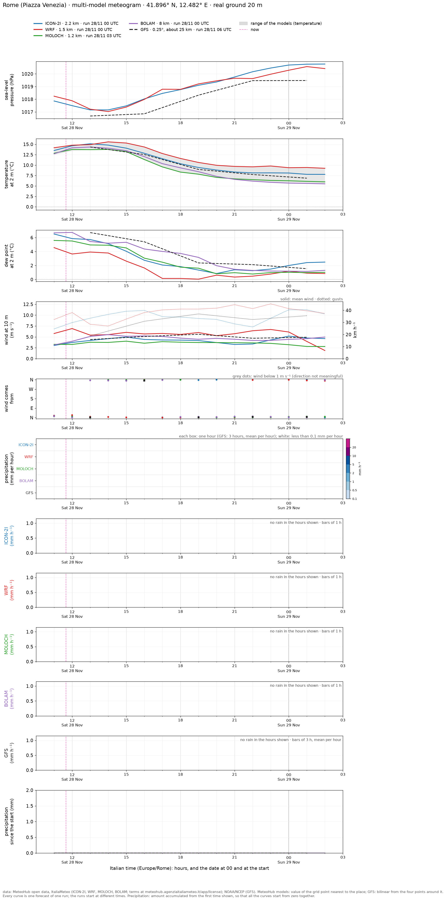

# Rome · multi-model meteogram

**Saturday 28 November 2026, 11:00 → 02:00** (Italian time) · updated 28/11 11:39



```
summary from Sat 28 Nov 10 UTC to Sun 29 Nov 01 UTC (precipitation up to Sun 29 Nov 01 UTC, the last time common to all the models):
model     run (UTC)         grid    point  ground  T min  T max  precip  max gust
ICON-2I   28/11 00        2.2 km   0.8 km    35 m    7.8   15.1  0.0 mm   40 km/h
WRF       28/11 00        1.5 km   0.3 km    41 m    9.2   15.6  0.0 mm   45 km/h
MOLOCH    28/11 03        1.2 km   0.2 km    n.a.    6.0   13.8  0.0 mm      n.a.
BOLAM     28/11 00          8 km   2.7 km    n.a.    5.5   14.3  0.0 mm      n.a.
GFS       28/11 06         0.25°   0.0 km    82 m    6.9   14.3  0.0 mm   37 km/h
spread of the models: highest temperature 13.8 to 15.6 °C; lowest 5.5 to 9.2 °C; precipitation 0.0 to 0.0 mm
'point': distance of the grid point used from the place; 'ground': height of the model ground there (Rome (Piazza Venezia): about 20 m; a model ground 100 m lower is about 0.65 °C warmer)
```

Models: ICON-2I (2.2 km), WRF (1.5 km), MOLOCH (1.2 km), BOLAM (8 km) from MeteoHub (ItaliaMeteo); GFS (25 km) from NOAA. Every curve is one forecast of one run.

Previous days: [27/11](meteograms/meteogram_Rome_2026112718.png) · [26/11](meteograms/meteogram_Rome_2026112618.png) · [25/11](meteograms/meteogram_Rome_2026112518.png) · [24/11](meteograms/meteogram_Rome_2026112419.png) · [23/11](meteograms/meteogram_Rome_2026112320.png) · [22/11](meteograms/meteogram_Rome_2026112216.png) · [21/11](meteograms/meteogram_Rome_2026112116.png) · [20/11](meteograms/meteogram_Rome_2026112017.png) · [19/11](meteograms/meteogram_Rome_2026111917.png) · [18/11](meteograms/meteogram_Rome_2026111817.png) · [17/11](meteograms/meteogram_Rome_2026111717.png) · [16/11](meteograms/meteogram_Rome_2026111618.png) · [15/11](meteograms/meteogram_Rome_2026111506.png)
