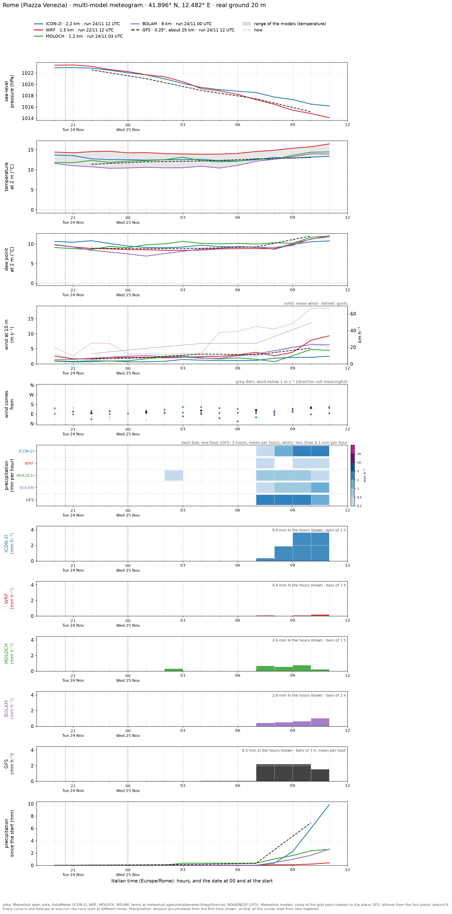

# Rome · multi-model meteogram

**Tuesday 24 November 2026, 20:00 → 11:00** (Italian time) · updated 24/11 20:35



```
summary from Tue 24 Nov 19 UTC to Wed 25 Nov 10 UTC (precipitation up to Wed 25 Nov 10 UTC, the last time common to all the models):
model     run (UTC)         grid    point  ground  T min  T max  precip  max gust
ICON-2I   24/11 12        2.2 km   0.8 km    35 m   12.2   13.7  9.9 mm   25 km/h
WRF       22/11 12        1.5 km   0.3 km    41 m   13.9   16.5  0.4 mm   66 km/h
MOLOCH    24/11 03        1.2 km   0.2 km    n.a.   11.8   14.4  2.6 mm      n.a.
BOLAM     24/11 00          8 km   2.7 km    n.a.   10.4   14.0  2.6 mm      n.a.
GFS       24/11 12         0.25°   0.0 km    82 m   11.4   13.0  8.5 mm   49 km/h
spread of the models: highest temperature 13.0 to 16.5 °C; lowest 10.4 to 13.9 °C; precipitation 0.4 to 9.9 mm
'point': distance of the grid point used from the place; 'ground': height of the model ground there (Rome (Piazza Venezia): about 20 m; a model ground 100 m lower is about 0.65 °C warmer)
```

Models: ICON-2I (2.2 km), WRF (1.5 km), MOLOCH (1.2 km), BOLAM (8 km) from MeteoHub (ItaliaMeteo); GFS (25 km) from NOAA. Every curve is one forecast of one run.

Previous days: [23/11](meteograms/meteogram_Rome_2026112320.png) · [22/11](meteograms/meteogram_Rome_2026112216.png) · [21/11](meteograms/meteogram_Rome_2026112116.png) · [20/11](meteograms/meteogram_Rome_2026112017.png) · [19/11](meteograms/meteogram_Rome_2026111917.png) · [18/11](meteograms/meteogram_Rome_2026111817.png) · [17/11](meteograms/meteogram_Rome_2026111717.png) · [16/11](meteograms/meteogram_Rome_2026111618.png) · [15/11](meteograms/meteogram_Rome_2026111506.png) · [14/11](meteograms/meteogram_Rome_2026111423.png) · [14/11](meteograms/meteogram_Rome_2026111409.png) · [13/11](meteograms/meteogram_Rome_2026111315.png) · [13/11](meteograms/meteogram_Rome_2026111309.png)
